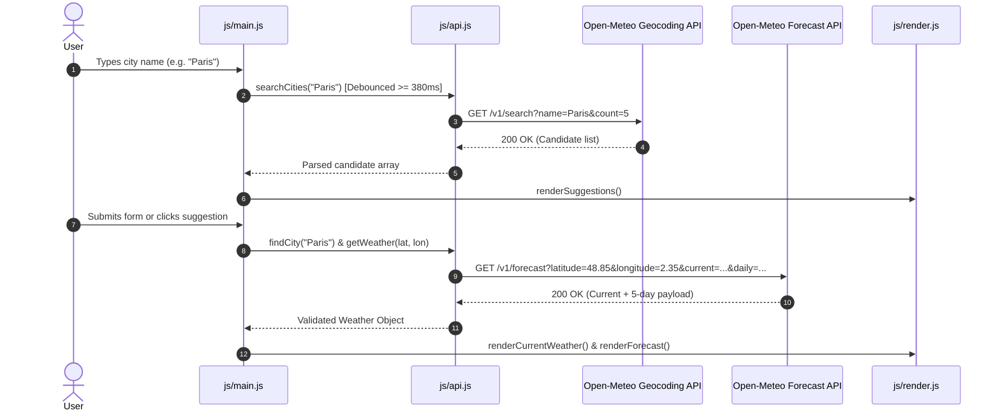

# AeroCast — Production-Quality Live Weather Dashboard

> A portfolio-grade, accessible, and responsive Live Weather Dashboard built strictly with **vanilla HTML5, CSS3, and ES2020+ JavaScript modules**. Zero frameworks, zero build tools, zero external JavaScript libraries, and zero API keys required. Engineered to run directly with VS Code Live Server and deploy as-is to GitHub Pages.

---

## 📸 Preview & Live Demo

- **Live Demo**: `https://<your-username>.github.io/weather-dashboard/` *(Placeholder: replace with your repository URL)*
- **Local Test Suite**: Open `tests.html` in your browser to inspect automated unit tests.

---

## 🌟 Key Features & Uniqueness Highlights

1. **🧠 Smart Lifestyle & Weather Advisory Engine (Signature Feature)**:
   - Evaluates current meteorological conditions and computes 4 actionable real-time lifestyle advisories:
     - **Outdoor Activity Index**: Analyzes thermal comfort, wind, and precipitation to score fitness/running suitability (Prime, Moderate, or Caution).
     - **Smart Umbrella & Rain Watch**: Scans the next 12 hours of hourly forecast data and warns of peak precipitation likelihood and exact hour (e.g., *"Up to 85% rain likelihood around 3:00 PM — grab an umbrella!"*).
     - **Clothing & Layering Guide**: Recommends appropriate attire based on apparent feels-like temperature and wind chill.
     - **UV Sun Exposure & Protection**: Translates daily UV index into dermatological protection advice (SPF recommendations and peak sun hazard hours).
2. **🕒 24-Hour Hourly Timeline Scroller**:
   - Smooth horizontal touch and scroll-wheel timeline detailing the upcoming 24 consecutive hours.
   - Real-time hourly temperature, condition icons, and rain probability badges.
3. **☀️ Celestial Daylight & Solar Arc Visualizer**:
   - An elegant mathematical SVG arc mapping the sun's trajectory across the sky in real-time.
   - Calculates dawn, dusk, total daylight hours, and remaining daylight countdown with a glowing celestial orb.
4. **✨ Living Weather Ambience Particle Engine**:
   - Ultra-lightweight HTML5 Canvas backdrop generating living atmospheric weather effects matching live conditions (drifting snowflakes, soft raindrops, twinkling night stars, golden sun shimmer, or rolling fog mist).
   - Fully accessible: includes a header toggle switch and automatically halts under `prefers-reduced-motion` or when the browser tab is hidden.
5. **📋 One-Click Share & Copy Weather Briefing**:
   - A dedicated "Share Briefing" action in the hero card that generates a formatted report and copies it to clipboard with an interactive floating glassmorphic toast notification.
6. **Zero External Dependencies & Strict CSP**:
   - Zero CDNs, zero third-party JS libraries, zero NPM packages, zero API keys.
   - Hand-crafted inline SVG weather icon sprite with `currentColor` styling.
   - Strict Content Security Policy (`Content-Security-Policy` meta tag) permitting connections *only* to `'self'` and the two official Open-Meteo API origins.
7. **Accessible ARIA Combobox Autocomplete**:
   - Debounced search (380ms) querying candidate cities.
   - Full W3C ARIA Combobox implementation: `role="combobox"`, `aria-autocomplete="list"`, `aria-expanded`, `aria-activedescendant`, `role="listbox"`, and `role="option"`.
   - Full keyboard navigation: `ArrowDown`/`ArrowUp` to navigate, `Enter` to select, `Escape` to dismiss.
8. **Robust Request Management & Race Condition Safety**:
   - `AbortController` automatically aborts any in-flight request when a new search or selection is made, eliminating race conditions.
   - 8-second request timeout enforcement via composite signal triggers.
   - One automatic retry with exponential backoff on transient network drops or HTTP 5xx errors.
9. **Resilient Error Architecture & Typed Errors**:
   - Custom typed error classes: `ValidationError`, `NotFoundError`, `NetworkError`, `ApiError`, `TimeoutError`.
   - Friendly user alerts with contextual "Try Again" action buttons for retryable errors.
10. **Instant Client-Side Unit Switching**:
    - Switch between Metric (°C, km/h) and Imperial (°F, mph) with real `<button>` elements utilizing `aria-pressed`.
    - Conversions happen 100% client-side from stored raw data with zero redundant API calls.
11. **Smart In-Memory & Session Caching**:
    - 10-minute TTL cache keyed by coordinate pairs (`lat,lon`), saving bandwidth and preventing rate limiting.
    - Displays relative updated time ("Updated 2m ago") and a manual "Refresh" button.
12. **Dynamic Weather & Day/Night Theming**:
    - CSS custom property themes adapting dynamically based on WMO weather codes and `is_day` flags (Clear Day, Clear Night, Overcast, Rain, Thunderstorm, Snow, Fog).
    - High contrast guaranteed (WCAG AA contrast ratio ≥ 4.5:1 across all themes).
    - Manual Light/Dark mode toggle respecting `prefers-color-scheme`.
13. **Responsive Layout & Zero Layout Shift (CLS = 0)**:
    - Shimmer skeleton loaders matching the exact dimensions of final loaded cards.
    - Fluid typography using CSS `clamp()`.
    - Verified responsive across 360px (mobile), 768px (tablet), 1280px (desktop), and 1920px (large screens).
    - Dedicated clean print stylesheet (`@media print`).

---

## 📂 Project Structure

```
weather-dashboard/
├── index.html              # Semantic HTML5 entry point & strict CSP
├── tests.html              # Standalone browser test suite (plain JS assertions)
├── css/
│   ├── base.css            # CSS reset, design tokens, dynamic themes, typography
│   ├── components.css      # Combobox, hero card, metrics, forecast, skeletons
│   └── responsive.css      # Breakpoints (360px-1920px), reduced-motion, print styles
├── js/
│   ├── config.js           # API endpoints, limits, timeouts, storage keys
│   ├── api.js              # findCity, searchCities, getWeather, fetchJson with retry
│   ├── weatherCodes.js     # WMO code -> label, SVG icon key, and theme key mapping
│   ├── advisory.js         # Smart lifestyle engine (Activity, Umbrella, Dressing, UV, Solar Arc)
│   ├── ambience.js         # Living weather particle canvas engine (Rain, Snow, Stars, Shimmer)
│   ├── render.js           # Pure DOM rendering (createElement + textContent ONLY)
│   ├── state.js            # Reactive UI state machine (idle | loading | success | empty | error)
│   ├── storage.js          # Safe localStorage/sessionStorage wrapper with try/catch
│   ├── utils.js            # Debounce, validators, formatters, unit converters, typed errors
│   └── main.js             # Bootstrap, event wiring, combobox controls, orchestration
├── assets/icons/
│   └── weather-icons.svg   # Hand-crafted SVG weather icon sprite
└── README.md               # Technical documentation & internship review notes
```

---

## 🔄 API Flow: Geocoding & Forecast

The application uses two endpoints from the free **Open-Meteo API** (no API key required):



---

## 🛡️ Security & XSS Prevention

- **Zero innerHTML**: Dynamic and user-facing data is mounted exclusively through `document.createElement`, `element.textContent`, and SVG namespace element builders (`createElementNS`).
- **Input Sanitization**: User inputs are trimmed, normalized, stripped of repeated whitespaces, length-bounded (≤ 80 characters), and validated with Unicode-aware regexes (`/\p{L}/u`) to reject pure digit/symbol injections.
- **Strict Content Security Policy**:
  ```html
  <meta http-equiv="Content-Security-Policy" content="default-src 'self'; script-src 'self'; style-src 'self' 'unsafe-inline'; img-src 'self' data:; connect-src 'self' https://geocoding-api.open-meteo.com https://api.open-meteo.com;">
  ```

---

## ♿ Accessibility (WCAG 2.1 AA)

- **Semantic Landmarks**: `<header role="banner">`, `<form role="search">`, `<main id="weather-content">`, `<footer role="contentinfo">`.
- **Screen Reader Announcements**: Live region (`#status-announcer` with `aria-live="polite"` and `aria-atomic="true"`) notifies screen readers upon search initiation, cache hits, successful loads, and errors.
- **Keyboard Navigation**:
  - Full tab stop sequence with high-contrast `:focus-visible` indicators.
  - Combobox suggestions support `ArrowDown`, `ArrowUp`, `Enter`, and `Escape`.
- **Motion & Contrast**:
  - Respects `@media (prefers-reduced-motion: reduce)` by disabling shimmer effects, card transitions, and spin animations.
  - Respects Windows High Contrast / Forced Colors mode (`@media (forced-colors: active)`).

---

## 🚀 How to Run Locally

### Option 1: VS Code Live Server (Recommended)
1. Open the project folder (`weather-dashboard` or workspace root) in Visual Studio Code.
2. Ensure the **Live Server** extension (by Ritwick Dey) is installed.
3. Right-click `index.html` and click **"Open with Live Server"** (or click "Go Live" in the status bar).
4. The dashboard will automatically launch at `http://127.0.0.1:5500/index.html`.

### Option 2: Simple Local Python / Node Server
```bash
# Using Python 3:
python -m http.server 8000

# Or using npx:
npx serve .
```
Navigate to `http://localhost:8000`.

---

## 🌐 GitHub Pages Deployment

1. Create a new GitHub repository: `weather-dashboard`.
2. Push your files to the `main` branch:
   ```bash
   git init
   git add .
   git commit -m "feat: initial production-ready weather dashboard release"
   git branch -M main
   git remote add origin https://github.com/<your-username>/weather-dashboard.git
   git push -u origin main
   ```
3. In your GitHub repository:
   - Go to **Settings** > **Pages**.
   - Under **Build and deployment** > **Source**, choose **Deploy from a branch**.
   - Select `main` branch and `/ (root)` folder.
   - Click **Save**.
4. Your site will be live within 1–2 minutes at:
   `https://<your-username>.github.io/weather-dashboard/`

---

## 🧪 Running Automated Unit Tests

Open `tests.html` in any modern web browser or open it through Live Server:
- `http://127.0.0.1:5500/tests.html`

The test runner will automatically execute and display real-time assertions for:
- Input validator edge cases (empty strings, Unicode accents, pure numbers/symbols, max length).
- Temperature and wind speed conversions (°C ↔ °F, km/h ↔ mph).
- Debounce execution and cancellation timing.
- WMO Weather Code map completeness across all 28 supported codes.
- Query parameter URL encoding.

---

## 📝 Error Handling Note (Internship Submission Document)

> **Architectural Error-Handling Strategy**
> 
> The application treats error handling as a first-class user experience priority rather than an afterthought. Every failure scenario is classified into a typed error hierarchy (`ValidationError`, `NotFoundError`, `NetworkError`, `ApiError`, `TimeoutError`) and routed through a single reactive state machine in `state.js`.
> 
> 1. **Client-Side Validation**: Form submission triggers `validateCity()`, which verifies string lengths (≤ 80 chars), collapses whitespaces, and ensures Unicode letter presence. Invalid inputs highlight the field with `aria-invalid="true"` and an inline error linked via `aria-describedby` without triggering network overhead.
> 2. **Network Failures & Timeouts**: The `fetchJson()` utility enforces an 8-second `AbortSignal` timeout and verifies `response.ok`. Network drops and HTTP 5xx responses trigger one automatic retry with exponential backoff (`CONFIG.TIMING.RETRY_DELAY_MS`). If exhaustion occurs, friendly cards explain the issue and provide a "Try Again" button.
> 3. **City Not Found**: If geocoding returns an empty candidate list, a specific `NotFoundError` is thrown with instructions to check spelling.
> 4. **Race Conditions**: Every search instantiates a fresh `AbortController`, automatically canceling stale in-flight requests.
> 5. **Geolocation Rejections**: Denied permissions or hardware timeouts are captured via `navigator.geolocation` error codes and surface non-blocking contextual guidance while maintaining existing dashboard data.
# weather-api

